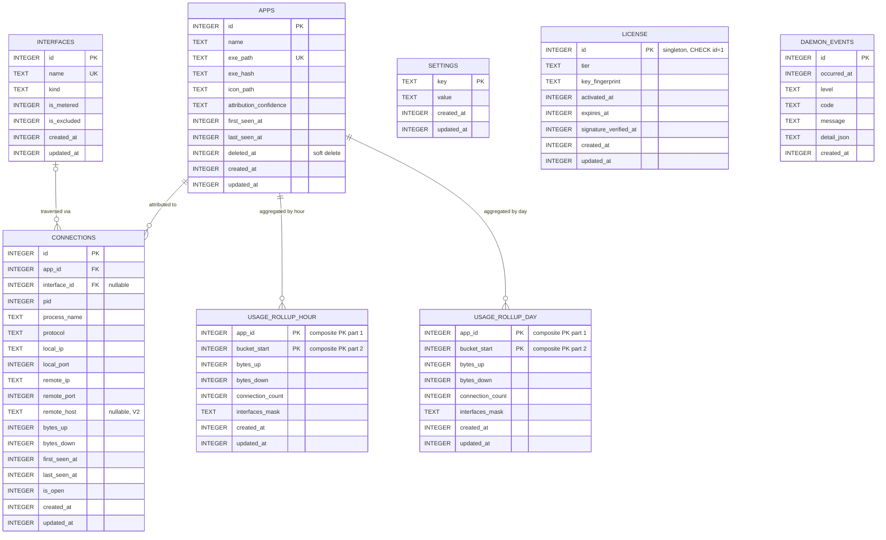

# Net Watch Pro — DATABASE.md (Database Design)

**Version:** 1.0 · **Date:** 2026-11-14  
**Source of truth:** `PRD.md` (retention, freemium, metered interfaces) · `ARCHITECTURE.md` §5.4 (table contract) · `REAPM.md` (reference history behavior)  
**Engine:** SQLite ≥ 3.40, **WAL mode**, `synchronous=NORMAL`, single file at `$NETWATCH_DATA_DIR/netwatch.db`

> **Binding rules:** This file is the single source of truth for schema. DDL lives only in forward-only sqlx migrations (`crates/netwatchd/src/db/migrations/*.sql`) and must match this file exactly. Changes require a version bump here + a new migration — never edit an applied migration (ARCHITECTURE.md §8.2).

---

## 1. Global Conventions

- **Naming:** all tables/columns/indexes `snake_case`; plural table names (ARCHITECTURE.md §8.1).
- **Timestamps:** `INTEGER` Unix epoch **seconds, UTC** (`unixepoch()`). Suffixes: `*_at`. Every table has `created_at` and `updated_at`.
- **updated_at maintenance:** one standard trigger pair per table (`{table}_set_created_at`, `{table}_set_updated_at`) created in the table's migration; triggers use `strftime('%s','now')`. Not repeated per-table below.
- **IDs:** surrogate `INTEGER PRIMARY KEY` (SQLite rowid) unless stated otherwise; composite natural keys where the grain demands it.
- **Booleans:** `INTEGER` 0/1 with `CHECK (x IN (0,1))`.
- **IPs:** canonical `TEXT` (IPv4/IPv6 string form) — simple, debuggable, indexed fine at this data volume; documented deviation from binary storage for simplicity.
- **Bytes:** `INTEGER` (64-bit) cumulative deltas per episode; never floating point.
- **Soft delete:** used only where history/audit value survives deletion intent → `apps.deleted_at`. NOT used on `connections` (pruning is the product's documented retention behavior, PRD §6.1 #5) and NOT on rollups (they are derived data, rebuildable).
- **Foreign keys:** `PRAGMA foreign_keys = ON` at every daemon connection; `ON DELETE` behavior stated per column below.

---

## 2. Tables

### 2.1 `schema_migrations`

Ledger of applied migrations (complements sqlx's internal `_sqlx_migrations`; this is the human/audit view).

| Column | Type | PK/FK | Default | Constraints |
|---|---|---|---|---|
| `version` | INTEGER | PK | — | monotonic, matches migration file number |
| `name` | TEXT | | — | NOT NULL, unique with version |
| `applied_at` | INTEGER | | — | NOT NULL (= created_at) |
| `created_at` / `updated_at` | INTEGER | | now | NOT NULL |

### 2.2 `apps`

Registry of attributed applications (ARCHITECTURE.md §5.1 step 2). One row per distinct executable identity.

| Column | Type | PK/FK | Default | Constraints |
|---|---|---|---|---|
| `id` | INTEGER | PK | auto | |
| `name` | TEXT | | — | NOT NULL (display name) |
| `exe_path` | TEXT | | — | NOT NULL, **UNIQUE** (attribution identity) |
| `exe_hash` | TEXT | | NULL | SHA-256 of binary when resolvable; NULL allowed (updates change hash) |
| `icon_path` | TEXT | | NULL | NULL → UI fallback container (DESIGN.md §6.2) |
| `attribution_confidence` | TEXT | | `'exact'` | CHECK IN (`'exact'`,`'heuristic'`,`'unknown'`) — PRD R3 confidence display |
| `first_seen_at` | INTEGER | | — | NOT NULL |
| `last_seen_at` | INTEGER | | — | NOT NULL |
| `deleted_at` | INTEGER | | NULL | **soft delete**; set when pruning removes last activity; rows kept for history joins |
| `created_at` / `updated_at` | INTEGER | | now | NOT NULL |

### 2.3 `interfaces`

Known network interfaces; drives the per-interface dashboard breakdown and metered labeling (PRD §6.1 #8, OQ5).

| Column | Type | PK/FK | Default | Constraints |
|---|---|---|---|---|
| `id` | INTEGER | PK | auto | |
| `name` | TEXT | | — | NOT NULL, **UNIQUE** (e.g. `wlan0`, `enp3s0`) |
| `kind` | TEXT | | `'ethernet'` | CHECK IN (`'ethernet'`,`'wifi'`,`'tun'`,`'loopback'`,`'other'`) |
| `is_metered` | INTEGER | | `0` | CHECK bool; user-set or NM import (OQ5) |
| `is_excluded` | INTEGER | | `0` | CHECK bool; e.g. exclude loopback from totals |
| `created_at` / `updated_at` | INTEGER | | now | NOT NULL |

### 2.4 `connections`

One row per connection episode (grain defined in ARCHITECTURE.md §5.4). The high-volume table; retention pruning targets it (PRD 90-day default).

| Column | Type | PK/FK | Default | Constraints |
|---|---|---|---|---|
| `id` | INTEGER | PK | auto | |
| `app_id` | INTEGER | FK → `apps.id` | — | NOT NULL, `ON DELETE RESTRICT` (apps are soft-deleted, never hard) |
| `interface_id` | INTEGER | FK → `interfaces.id` | NULL | `ON DELETE SET NULL` (interface may vanish from system) |
| `pid` | INTEGER | | — | NOT NULL (snapshot at attribution; not a live reference) |
| `process_name` | TEXT | | NULL | snapshot; display fallback if app row pruned semantics change |
| `protocol` | TEXT | | — | CHECK IN (`'tcp'`,`'udp'`,`'icmp'`,`'other'`) |
| `local_ip` | TEXT | | — | NOT NULL |
| `local_port` | INTEGER | | — | NOT NULL, CHECK 0–65535 |
| `remote_ip` | TEXT | | — | NOT NULL |
| `remote_port` | INTEGER | | — | NOT NULL, CHECK 0–65535 |
| `remote_host` | TEXT | | NULL | PTR/display name (V2 DNS display, PRD §6.2 #3); never overwrites remote_ip |
| `bytes_up` | INTEGER | | `0` | NOT NULL, CHECK ≥ 0 |
| `bytes_down` | INTEGER | | `0` | NOT NULL, CHECK ≥ 0 |
| `packets_up` / `packets_down` | INTEGER | | `0` | NOT NULL, CHECK ≥ 0 |
| `first_seen_at` | INTEGER | | — | NOT NULL |
| `last_seen_at` | INTEGER | | — | NOT NULL, CHECK ≥ first_seen_at |
| `is_open` | INTEGER | | `1` | CHECK bool; 0 when episode ended (live view filter, DESIGN.md §8.4) |
| `created_at` / `updated_at` | INTEGER | | now | NOT NULL |

**No soft delete:** rows are deleted by the retention pruner; "deleted" history is a *product feature* (PRD §6.1 #5), not an accident.

### 2.5 `usage_rollup_hour` and `usage_rollup_day`

Per-app aggregated usage. `connections` older than the raw window (7 days) is compacted into these (ARCHITECTURE.md §5.4 policy). Both tables share the same shape; shown once.

| Column | Type | PK/FK | Default | Constraints |
|---|---|---|---|---|
| `app_id` | INTEGER | **PK (part 1)**, FK → `apps.id` | — | NOT NULL, `ON DELETE RESTRICT` |
| `bucket_start` | INTEGER | **PK (part 2)** | — | NOT NULL; hour/day-aligned epoch (UTC); grain = table name |
| `bytes_up` | INTEGER | | `0` | NOT NULL, CHECK ≥ 0 |
| `bytes_down` | INTEGER | | `0` | NOT NULL, CHECK ≥ 0 |
| `connection_count` | INTEGER | | `0` | NOT NULL, CHECK ≥ 0 |
| `interfaces_mask` | TEXT | | NULL | comma-separated interface names contributing (compact provenance; avoids a rollup×interface many-to-many) |
| `created_at` / `updated_at` | INTEGER | | now | NOT NULL |

PK = composite `(app_id, bucket_start)` — no surrogate id: the grain *is* the key, and it makes upserts (`INSERT … ON CONFLICT DO UPDATE`) atomic. System-wide totals for the Dashboard are `SUM` over apps at query time (apps count is small); no second system-level rollup table. **No soft delete** (derived data).

### 2.6 `settings`

Daemon-side settings mirror (PRD §6.1 #8; UI edits via API `settings.set`).

| Column | Type | PK/FK | Default | Constraints |
|---|---|---|---|---|
| `key` | TEXT | PK | — | NOT NULL (e.g. `retention_days`, `start_on_boot`) |
| `value` | TEXT | | — | NOT NULL (typed at application layer; documented per key in `docs/api-contract.md`) |
| `created_at` / `updated_at` | INTEGER | | now | NOT NULL |

No soft delete (settings keys are fixed enum; removal is a migration concern).

### 2.7 `license`

Singleton freemium license record (PRD §6.1 #9): exactly one row (`id = 1`).

| Column | Type | PK/FK | Default | Constraints |
|---|---|---|---|---|
| `id` | INTEGER | PK | — | CHECK (`id = 1`) — enforced singleton |
| `tier` | TEXT | | `'free'` | CHECK IN (`'free'`,`'pro'`) |
| `key_fingerprint` | TEXT | | NULL | NOT NULL when tier=`'pro'`; SHA-256 fingerprint of the signed key (raw key never stored) |
| `activated_at` | INTEGER | | NULL | NOT NULL when tier=`'pro'` |
| `expires_at` | INTEGER | | NULL | NULL = perpetual (offline validation per PRD; no server check) |
| `signature_verified_at` | INTEGER | | NULL | last successful offline verification with embedded public key |
| `created_at` / `updated_at` | INTEGER | | now | NOT NULL |

### 2.8 `daemon_events`

Bounded diagnostics log for the Diagnostics modal and degraded-state evidence (DESIGN.md §8.9, ARCHITECTURE.md §7). NOT a general log file — only state-relevant events.

| Column | Type | PK/FK | Default | Constraints |
|---|---|---|---|---|
| `id` | INTEGER | PK | auto | |
| `occurred_at` | INTEGER | | — | NOT NULL (indexed; this table's "created_at" semantic; no updated_at — immutable log) |
| `level` | TEXT | | `'info'` | CHECK IN (`'info'`,`'warn'`,`'error'`) |
| `code` | TEXT | | — | NOT NULL; values from the ARCHITECTURE.md §7.2 taxonomy (e.g. `EBPF_ATTACH_FAILED`) |
| `message` | TEXT | | — | NOT NULL, ≤ 2000 chars CHECK |
| `detail_json` | TEXT | | NULL | optional structured context |
| `created_at` | INTEGER | | now | NOT NULL (kept for convention; = occurred_at at insert) |

Capped ring: keeps newest 5,000 rows; pruned by the same pruner task. **Exception to the every-column rule:** no `updated_at` — rows are immutable by design.

---

## 3. Relationships

| Relationship | Cardinality | Explanation |
|---|---|---|
| `apps` → `connections` | **one-to-many** | Each connection episode belongs to exactly one app (`app_id` NOT NULL). An app accrues many connection rows over time. Deleting an app is a soft delete, so history always resolves. |
| `interfaces` → `connections` | **one-to-many**, optional | A connection may reference the interface it traversed; NULL when the interface left the system (`ON DELETE SET NULL`). |
| `apps` → `usage_rollup_hour` / `_day` | **one-to-many** | Rollups are per-app time buckets; compaction replaces old `connections` rows with rollup rows (grain shift, same entity). |
| `connections` ↔ `remote hosts` | **no host table (by design)** | Remote hosts/IPs/ports are attributes of connections, not entities — normalizing them would add joins to the hottest table for zero integrity benefit. Endpoint summaries (App detail, DESIGN.md §8.5) aggregate in queries. |
| `license` | **one-to-one with the database itself** | Singleton row (`CHECK id=1`). |
| `settings`, `schema_migrations`, `daemon_events` | **standalone** | No FKs — infrastructure tables. |

**No many-to-many relationships exist** in this schema. The one candidate (rollups × interfaces) is intentionally flattened into `interfaces_mask` (§2.5) to keep rollup upserts single-statement and the compaction job simple — a documented denormalization, revisited only if per-interface rollup queries become a product need.
---

## 4. ER Diagram (Mermaid)



---

## 5. Indexes (for the most common queries)

Each index names the PRD/DESIGN query it serves. Indexes live in the same migration as their table (§8) except where noted.

| Index | DDL shape (names snake_case) | Serves |
|---|---|---|
| `idx_connections_app_first_seen` | `(app_id, first_seen_at DESC)` | App detail timeline; History filtered by app + date range (§8.4/§8.5) |
| `idx_connections_last_seen` | `(last_seen_at)` | Live view: open episodes with `last_seen_at > now - 60s` (§8.4); retention pruning scan |
| `idx_connections_remote_ip` | `(remote_ip)` | Endpoint summary "where did this app connect"; History filter by remote host/IP (Pro, §8.6) |
| `idx_connections_open` | `(is_open, last_seen_at DESC)` **partial**: `WHERE is_open = 1` | Live connections snapshot — the hottest query every second |
| `idx_connections_remote_host` | `(remote_host)` | History hostname search (V2 DNS display); created in migration 0003 when the column becomes queryable |
| `idx_daemon_events_occurred` | `(occurred_at DESC)` | Diagnostics dump (latest N) |
| `idx_apps_last_seen` | `(last_seen_at DESC)` | Top-apps ranking; pruner's last-activity check for soft delete |
| *(PK)* `usage_rollup_*` | composite `(app_id, bucket_start)` | Dashboard timeline (Day/Hour toggle), usage by period — PK range scan, no extra index |
| *(UK)* `apps.exe_path` / `interfaces.name` | unique | attribution upsert path; interface registration |

**Anti-indexes:** no index on `remote_port`, `local_*`, `bytes_*`, `packets_*` — no first-class query uses them alone (port filter always co-occurs with app/host in the Pro filter set, served by the filtered scan of a small result set). Every index must name its query in the migration comment or it doesn't ship.
---

## 6. Access Rules

**SQLite has no row-level security** — instead, security is layered at the process boundary (this is the honest equivalent, consistent with REAPM.md §12's model):

| Layer | Rule |
|---|---|
| Filesystem | DB + WAL/SHM live in `/var/lib/netwatch-pro` (root:root, mode `0750`; DB file `0640`). Only root (`netwatchd`) can open the database. The systemd unit's sandboxing (PRD §5) protects the directory. |
| UI | **Never opens the database.** All reads/writes go through the loopback token-authenticated API (ARCHITECTURE.md §5.3). A compromised UI can only do what the API permits. |
| API | Writes are endpoint-scoped: `settings.set` (validated keys only), `license.activate`, `export.request` (server-side Pro check against `license.tier` — gating is never UI-only, PRD R7). Read endpoints are unprivileged within the local trust boundary. |
| Row-level rules (application-enforced) | `connections`/rollups beyond the free tier's raw window are not withheld at row level; retention *tiering* is enforced at compaction (Pro = longer raw window + 1-year rollups, free = 90-day prune). The pruner is the enforcer, not a view. |
| Backups | `VACUUM INTO` via CLI verb, root-only; no other copy of the file is ever made by the app. |

---

## 7. Sample Seed Data (migration 0001 inserts)

Seed = defaults the daemon needs before first run; **no fake traffic ships** (demo mode is a separate fixture set in `tests/fixtures/`, PRD OQ4).

```sql
-- settings defaults (§2.6)
INSERT INTO settings (key, value, created_at, updated_at) VALUES
  ('retention_days',   '90',  strftime('%s','now'), strftime('%s','now')),
  ('theme_default',    'system', strftime('%s','now'), strftime('%s','now')),
  ('start_on_boot',    '1',   strftime('%s','now'), strftime('%s','now')),
  ('metered_policy',   'ask', strftime('%s','now'), strftime('%s','now')),
  ('raw_window_days',  '7',   strftime('%s','now'), strftime('%s','now'));

-- license singleton (§2.7) — free tier until activated
INSERT INTO license (id, tier, created_at, updated_at)
  VALUES (1, 'free', strftime('%s','now'), strftime('%s','now'));

-- loopback registered so attribution has a target on day one (§2.3)
INSERT INTO interfaces (name, kind, is_metered, is_excluded, created_at, updated_at)
  VALUES ('lo', 'loopback', 0, 1, strftime('%s','now'), strftime('%s','now'));
```

Illustrative row *shapes* (from the accuracy harness, not shipped):

```sql
-- apps: one row per executable identity
INSERT INTO apps (id, name, exe_path, icon_path, attribution_confidence,
                  first_seen_at, last_seen_at, created_at, updated_at) VALUES
  (1, 'Firefox', '/usr/lib/firefox/firefox', '/usr/share/icons/hicolor/…/firefox.png',
   'exact', 1731567000, 1731570600, 1731567000, 1731570600);

-- connections: one row per episode
INSERT INTO connections (app_id, interface_id, pid, process_name, protocol,
  local_ip, local_port, remote_ip, remote_port, bytes_up, bytes_down,
  first_seen_at, last_seen_at, is_open, created_at, updated_at) VALUES
  (1, NULL, 2213, 'firefox', 'tcp', '192.168.1.23', 53210,
   '151.101.1.1', 443, 240000, 1980000, 1731567000, 1731570600, 0,
   1731567000, 1731570600);

-- rollups: hourly compaction of the above
INSERT INTO usage_rollup_hour (app_id, bucket_start, bytes_up, bytes_down,
  connection_count, interfaces_mask, created_at, updated_at) VALUES
  (1, 1731565200, 240000, 1980000, 1, 'wlan0', 1731574200, 1731574200);
```

---

## 8. Migration Order

Forward-only, numbered sqlx migrations; each runs in one transaction (SQLite DDL is transactional). Order is dependency-driven: parents before children, indexes with their tables, seeds last in their migration.

| # | File | Contents |
|---|---|---|
| 0001 | `0001_init_core.sql` | `schema_migrations`, `settings` (+seed), `license` (+seed), `interfaces` (+`lo` seed) |
| 0002 | `0002_apps_connections.sql` | `apps` (+`idx_apps_last_seen`), `connections` + `idx_connections_app_first_seen`, `idx_connections_last_seen`, `idx_connections_open`, `idx_connections_remote_ip`; FKs to 0001 tables |
| 0003 | `0003_rollups.sql` | `usage_rollup_hour`, `usage_rollup_day` (composite PKs, FKs), `idx_connections_remote_host` |
| 0004 | `0004_daemon_events.sql` | `daemon_events` + `idx_daemon_events_occurred` |
| 0005+ | future | forward-only additive changes; destructive changes only via expand→migrate→contract with a documented release gap |

Runtime rules (from ARCHITECTURE.md §5.4/§8.2): `PRAGMA foreign_keys=ON`, `journal_mode=WAL`, `synchronous=NORMAL` set on every connection open; migrations embedded in the binary; the daemon refuses to start on an unknown/newer schema (honest degraded state, not silent best-effort).

---

## 9. Governance

Same model as ARCHITECTURE.md §10: binding file; changes bump the version here and ship as a new migration. `docs/db-schema.md` in the repo mirrors §2–§5 (generated check: doc drift fails CI).

---

*End of DATABASE.md. No application code beyond illustrative SQL shapes for documentation.*
