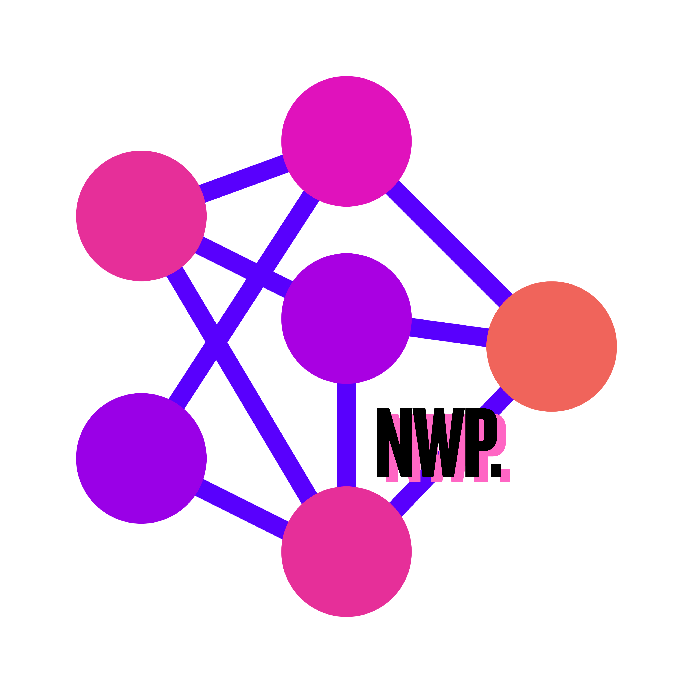
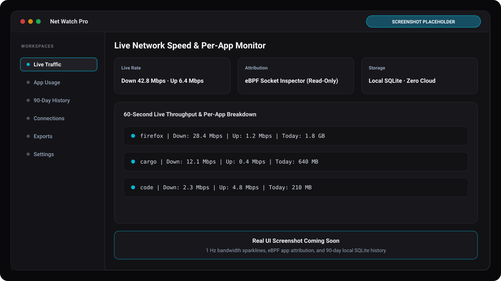
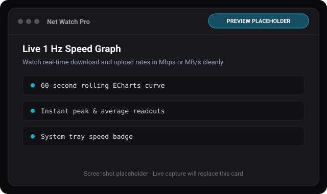
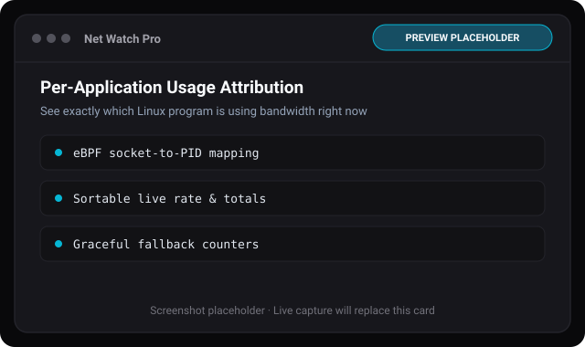
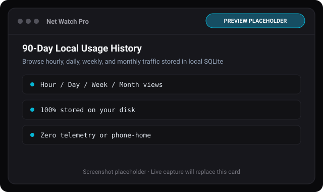
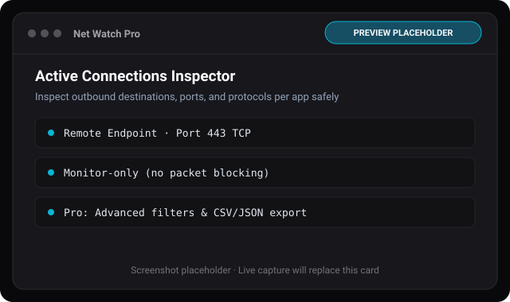
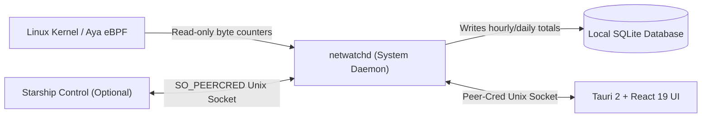

<div align="center">
  <a id="top"></a>
  <p>
    
  </p>

  <h1>Net Watch Pro</h1>

  <h3>Private, local-first Linux network speed monitor and per-app data tracker</h3>

  <p>
    See live bandwidth speeds, spot which program is using your connection, and keep 90 days of local history on disk with zero cloud servers.
  </p>

  <p>
    <a href="https://zvirox.in/projects/nwp/">Project Page</a> ·
    <a href="https://zvirox.in/downloads/nwp/">Download Packages</a> ·
    <a href="https://github.com/zvirox/net-watch-pro/releases">GitHub Releases</a> ·
    <a href="#quick-installation">Quick Install</a> ·
    <a href="#key-features">Features</a> ·
    <a href="#starship-control-integration">Starship Control</a> ·
    <a href="#maintainer-and-ecosystem">Maintainer</a> ·
    <a href="#frequently-asked-questions">FAQ</a>
  </p>

  <p>
    <a href="https://zvirox.in/downloads/nwp/">
      
    </a>
    <a href="https://github.com/zvirox/net-watch-pro/actions/workflows/ci.yml">
      
    </a>
    <a href="LICENSE">
      
    </a>
    
    
  </p>

  <table>
    <tr>
      <td align="right"><b>Start</b></td>
      <td align="center"><a href="#what-is-net-watch-pro">What It Is</a></td>
      <td align="center"><a href="#workspace-previews">Previews</a></td>
      <td align="center"><a href="#quick-installation">Install</a></td>
    </tr>
    <tr>
      <td align="right"><b>Features</b></td>
      <td align="center"><a href="#key-features">Key Capabilities</a></td>
      <td align="center"><a href="#how-traffic-tracking-works">Architecture</a></td>
      <td align="center"><a href="#tech-stack">Tech Stack</a></td>
    </tr>
    <tr>
      <td align="right"><b>Automation</b></td>
      <td align="center"><a href="#starship-control-integration">Starship Control</a></td>
      <td align="center"><a href="#real-world-use-cases">Use Cases</a></td>
      <td align="center"><a href="#how-connection-works">Socket Setup</a></td>
    </tr>
    <tr>
      <td align="right"><b>Community</b></td>
      <td align="center"><a href="#frequently-asked-questions">FAQ</a></td>
      <td align="center"><a href="#maintainer-and-ecosystem">Maintainer</a></td>
      <td align="center"><a href="#license">License</a></td>
    </tr>
  </table>
</div>

<br />

<p align="center">
  
  <br />
  <sub><b>Screenshot placeholder.</b> Net Watch Pro live speed monitor showing 1 Hz sparklines, per-app attribution, and local SQLite history.</sub>
</p>

---

## What is Net Watch Pro?

When your internet slows down suddenly, standard Linux indicators only show total download speed. They leave you guessing which program or background process is hogging bandwidth, while online monitoring tools want to upload your traffic logs to third-party servers.

Net Watch Pro runs purely on your Linux computer. A lightweight background daemon watches socket traffic through Linux eBPF counters and records totals in a local SQLite database, while an unprivileged Tauri desktop app renders clean live charts. Every byte stays on your own disk.

---

## Workspace Previews

<table>
  <tr>
    <td width="50%" valign="top">
      <br />
      <strong>Live 1 Hz Speed Monitor</strong><br />
      Follow download and upload rates second by second with smooth 60-second sparklines in Mbps or MB/s.
    </td>
    <td width="50%" valign="top">
      <br />
      <strong>Per-Application Attribution</strong><br />
      Pinpoint exactly which app is transferring data right now using fast Linux eBPF socket inspection.
    </td>
  </tr>
  <tr>
    <td width="50%" valign="top">
      <br />
      <strong>90-Day Local Usage History</strong><br />
      Inspect bandwidth summaries by hour, day, week, or month stored locally inside SQLite.
    </td>
    <td width="50%" valign="top">
      <br />
      <strong>Active Connections Inspector</strong><br />
      Browse active remote IP addresses, ports, and protocols for any running Linux application.
    </td>
  </tr>
</table>

---

## Key Features

- **Real-Time 1 Hz Speed Sparklines**: Watch download and upload activity update smoothly every second with selectable Mbps and MB/s units.
- **Exact Per-App Bandwidth Attribution**: Uses Linux kernel eBPF probes to tie network bytes directly to each running process and executable name.
- **90-Day Local SQLite History**: Browse daily, weekly, and monthly traffic totals stored on your disk with zero remote sync.
- **Active Connections View**: Inspect live remote IP destinations, ports, and protocols cleanly per application.
- **Optional Offline Pro Features**: Unlock advanced filters, CSV/JSON exports, and longer retention using an offline license key checked locally with zero network validation.
- **Strict Zero-Cloud Promise**: Net Watch Pro makes zero outbound telemetry, analytics, or update requests of its own.

---

## How Traffic Tracking Works

Net Watch Pro splits privileged kernel inspection from the unprivileged UI so the desktop window never runs as root.



| Tier | What Is Included | Connectivity Needed? |
| :--- | :--- | :---: |
| **Free Tier** | Live speed tracking, per-app usage, active connections, 90-day history | **None (100% Local)** |
| **Pro Tier (Offline Key)** | Advanced query filters, CSV/JSON export, extended retention | **None (Offline Key)** |

---

## Starship Control Integration *(Preview Bridge Module)*

Net Watch Pro is a self-contained monitoring application. You can watch live bandwidth graphs, check per-app totals, and inspect active connections without any extra software.

A standalone JSON-RPC integration bridge module (`crates/netwatch-api/src/starship_bridge.rs` built on `starship-plugin`) is included in the workspace for connecting with [Starship Control](https://github.com/zvirox/starship-control) ([Releases](https://github.com/zvirox/starship-control/releases)). Note: daemon startup spawning and live SQLite telemetry wiring inside `netwatchd` remain queued in `PLAN.md` Phase 12 (`P12.2`–`P12.3`).

### Target Capabilities (Phase 12)

- **Instant Bandwidth Diagnosis**: Query active top talkers and recent packet/flow summaries over `$XDG_RUNTIME_DIR/starship/bridges/nwp.sock`.
- **Quick Daily Totals**: Query per-app usage totals directly from local SQLite rollups.
- **Strict Local Privilege Boundary**: Manifest discovery via `$XDG_DATA_HOME/starship/plugins/nwp.json` paired with Linux `SO_PEERCRED` peer-credential checks so only processes running under your UID can connect — zero network ports opened.

---

## Quick Installation

Prebuilt Linux packages and checksum files are available on the [Releases page](https://github.com/zvirox/net-watch-pro/releases).

| Distribution | Package Format | Install Command |
| :--- | :--- | :--- |
| **Debian / Ubuntu / Pop!_OS / Mint** | `.deb` | `sudo apt install ./net-watch-pro_*_amd64.deb` |
| **Fedora / RHEL / openSUSE** | `.rpm` | `sudo dnf install ./net-watch-pro-*.x86_64.rpm` |
| **Arch Linux / Manjaro / CachyOS** | `.pkg.tar.zst` | `sudo pacman -U ./net-watch-pro-*-x86_64.pkg.tar.zst` |

<details>
<summary><strong>Verify Checksums and Build From Source</strong></summary>

Verify downloaded files using `SHA256SUMS`:

```bash
sha256sum -c SHA256SUMS --ignore-missing
```

To build directly from source, install Rust stable, Node.js 22+, `bpf-linker`, and Linux desktop libraries (`libglib2.0-dev`, `libgtk-3-dev`, `libwebkit2gtk-4.1-dev`, `librsvg2-dev`):

```bash
git clone https://github.com/zvirox/net-watch-pro.git
cd net-watch-pro
cargo run -p xtask -- bpf
cd app && npm ci && npm run build && cd ..
cargo build --release -p netwatch-app -p netwatchd
```

</details>

Official Linux releases ship exclusively as native `.deb`, `.rpm`, and `.pkg.tar.zst` packages alongside `SHA256SUMS` and `SHA256SUMS.sig`. Legacy AppImage, Flatpak, tarball, and AUR packages are retired and no longer updated.

---

## Tech Stack

| Layer | Technology | Role |
| :--- | :--- | :--- |
| **Background Daemon** | Rust + Tokio + Aya eBPF (`netwatchd`) | Low-overhead socket byte accounting and local SQLite persistence |
| **Desktop Shell** | Tauri 2 (`netwatch-app`) | Unprivileged desktop window, tray indicator, and socket client |
| **Frontend UI** | React 19 + TypeScript + Tailwind CSS v4 | Final & locked Linear Design System (`DESIGN.md` v3.0; dark `#050505` & light `#F3F4F6`) |
| **Charts and State** | Apache ECharts 6 + Zustand | Smooth 1 Hz throughput charts and reactive usage tables |
| **Automation Bridge** | `starship-plugin` SDK *(prototype module)* | JSON-RPC bridge module in `netwatch-api` (daemon wiring tracked in `PLAN.md` Phase 12) |

---

## Frequently Asked Questions

**Does Net Watch Pro block traffic like a firewall?**
No. Net Watch Pro is strictly a read-only monitor and bandwidth tracker. It observes traffic counts without slowing down or interfering with your network connections.

**Does Net Watch Pro send any analytics or data online?**
No. Zero telemetry, zero analytics, and zero cloud connections exist in the app. Your history lives in SQLite on your own drive.

**Is Starship Control required to use Net Watch Pro?**
No. Net Watch Pro works completely standalone with its own visual interface and tray icon. Starship Control is an optional companion for conversational queries.

**How does per-app attribution handle older kernels?**
On modern Linux kernels, `netwatchd` uses Aya eBPF to match sockets to process names cleanly. When kernel eBPF support is unavailable, it gracefully falls back to system interface counters.

---

## Maintainer and Ecosystem

<p align="center">
  <a href="https://www.zvirox.in">
    
  </a>
</p>

<p align="center">
  <strong>Prakashpuri Gauswami (<a href="https://github.com/zvirox">@zvirox</a>)</strong><br />
  Cybersecurity Analyst &amp; SOC Practitioner · Agentic AI Builder · Blue Team &amp; SIEM · Patan, Gujarat, India
</p>

<p align="center">
  <a href="https://github.com/sponsors/zvirox">
    
  </a>
  <a href="https://ko-fi.com/zvirox">
    
  </a>
</p>

I build local-first open-source Linux and Android tools under **Zvirox**. Writing real software helps me study system boundaries and security architecture hands-on while giving creators and Linux users fast desktop tools free from subscriptions and telemetry.

### Connect and Support

- **GitHub Profile**: [github.com/zvirox](https://github.com/zvirox)
- **Website**: [www.zvirox.in](https://www.zvirox.in)
- **Email**: [info@zvirox.in](mailto:info@zvirox.in)
- **Sponsor**: [GitHub Sponsors](https://github.com/sponsors/zvirox) · [Ko-fi](https://ko-fi.com/zvirox)
- **Socials**: [LinkedIn (`in/plgsevala`)](https://www.linkedin.com/in/plgsevala) · [YouTube (`@zvirox_in`)](https://www.youtube.com/@zvirox_in) · [Instagram (`plg.sevala`)](https://www.instagram.com/plg.sevala) · [Facebook (`plg.sevala`)](https://www.facebook.com/plg.sevala)

### Zvirox App Suite (Open-Source Project List)

All six applications in the Zvirox desktop suite work standalone and connect together through Starship Control:

| Logo | Application | Purpose | Repository | Download & Project |
| :---: | :--- | :--- | :--- | :--- |
|  | **[Starship Control](https://zvirox.in/projects/sc/)** | Local-first AI desktop cockpit and floating HUD | [github.com/zvirox/starship-control](https://github.com/zvirox/starship-control) | [Download](https://zvirox.in/downloads/sc/) · [Releases](https://github.com/zvirox/starship-control/releases) |
|  | **[Screen Studio Pro](https://zvirox.in/projects/ssp/)** | Wayland and X11 screen recorder with PipeWire | [github.com/zvirox/screen-studio-pro](https://github.com/zvirox/screen-studio-pro) | [Download](https://zvirox.in/downloads/ssp/) · [Releases](https://github.com/zvirox/screen-studio-pro/releases) |
|  | **[Easy Edits Pro](https://zvirox.in/projects/eep/)** | Non-destructive multitrack video editor | [github.com/zvirox/easy-edits-pro](https://github.com/zvirox/easy-edits-pro) | [Download](https://zvirox.in/downloads/eep/) · [Releases](https://github.com/zvirox/easy-edits-pro/releases) |
|  | **[Audio Labs Pro](https://zvirox.in/projects/alp/)** | Offline voice studio and multitrack audio editor | [github.com/zvirox/audio-labs-pro](https://github.com/zvirox/audio-labs-pro) | [Download](https://zvirox.in/downloads/alp/) · [Releases](https://github.com/zvirox/audio-labs-pro/releases) |
|  | **[Agentic Tuneup Pro](https://zvirox.in/projects/atp/)** | Safety-first disk cleaner and system optimizer | [github.com/zvirox/agentic-tuneup-pro](https://github.com/zvirox/agentic-tuneup-pro) | [Download](https://zvirox.in/downloads/atp/) · [Releases](https://github.com/zvirox/agentic-tuneup-pro/releases) |
|  | **[Net Watch Pro](https://zvirox.in/projects/nwp/)** | Real-time network speed and per-app data tracker | [github.com/zvirox/net-watch-pro](https://github.com/zvirox/net-watch-pro) | [Download](https://zvirox.in/downloads/nwp/) · [Releases](https://github.com/zvirox/net-watch-pro/releases) |
| - | **[Your TV Friend](https://zvirox.in/projects/ytf/)** | Android TV non-destructive debloater and Your UI launcher | [github.com/zvirox/your-tv-friend](https://github.com/zvirox/your-tv-friend) | [Download APK](https://zvirox.in/downloads/ytf/) · [Releases](https://github.com/zvirox/your-tv-friend/releases) |

---

## Star History

<p align="center">
  <a href="https://www.star-history.com/#zvirox/net-watch-pro&Date">
    <picture>
      <source media="(prefers-color-scheme: dark)" srcset="https://api.star-history.com/svg?repos=zvirox/net-watch-pro&type=Date&theme=dark" />
      <source media="(prefers-color-scheme: light)" srcset="https://api.star-history.com/svg?repos=zvirox/net-watch-pro&type=Date" />
      
    </picture>
  </a>
</p>

---

## License

Net Watch Pro is free, open-source software licensed under the [GNU Affero General Public License v3.0](LICENSE).

<div align="center">
  <br />
  <a href="#top"><strong>Back to top</strong></a> · Built in public by <a href="https://www.zvirox.in">Zvirox</a>
</div>
